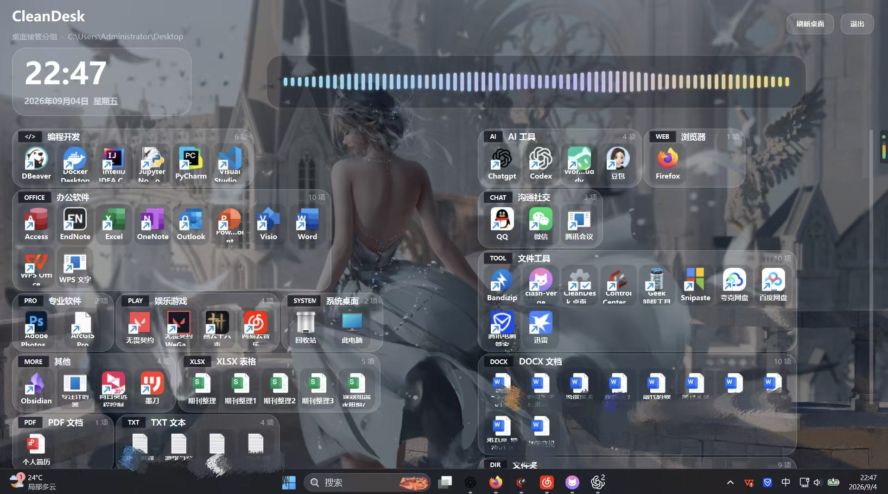

# CleanDesk

Windows 桌面分类启动器。自动分组、点击打开，不移动或删除原文件。

**[下载 Windows 免安装 EXE](https://github.com/IIndex404/CleanDesk-/releases/latest/download/CleanDesk.exe)** · Windows 10/11，64 位

下载后双击 `CleanDesk.exe`，无需安装 Python。首次启动需要几秒钟。



## 使用

- 自动归类桌面应用、文件和文件夹，支持公共桌面与 OneDrive 桌面。
- 桌面变化自动刷新，也可在系统托盘右键手动刷新。
- 点击卡片中的项目打开；托盘右键选择「退出并恢复原桌面」关闭。
- 顶部频谱随系统播放的声音变化。

程序暂未签名。首次运行可能出现 Windows SmartScreen 提示，请核对下载来源。

## 开发

```powershell
python -m venv .venv
.\.venv\Scripts\python -m pip install -r requirements-dev.txt
.\.venv\Scripts\python main.py --window
```

默认运行 `main.py` 进入桌面模式；`--restore-icons` 可恢复原生桌面图标。

测试与构建单文件 EXE：

```powershell
./scripts/build_windows.ps1 -Python ./.venv/Scripts/python.exe
```

产物：`release/CleanDesk.exe`。推送 `v*` 标签会自动构建并发布至 Releases。
